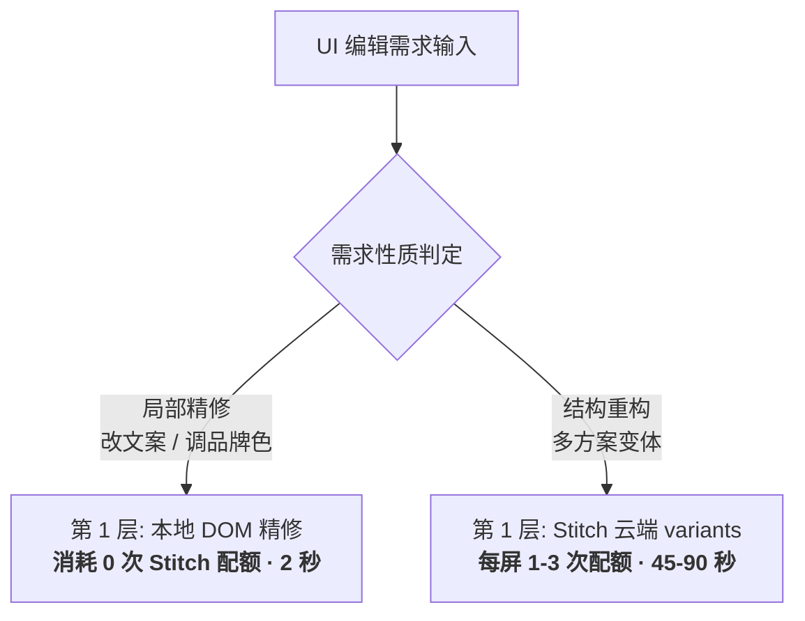
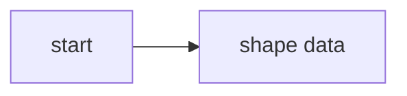

Mermaid e2e fixture.

1. Bold labels (reported case):



2. Unlabelled fence:

```
sequenceDiagram
    Agent->>Paseo: assistant message
    Paseo-->>Vec: rendered diagram
```

3. Blocked shape metadata:



4. Syntax error:

```mermaid
flowchart TD
    A[open (paren] --> B
```
